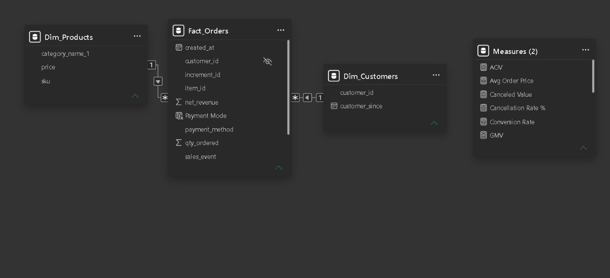
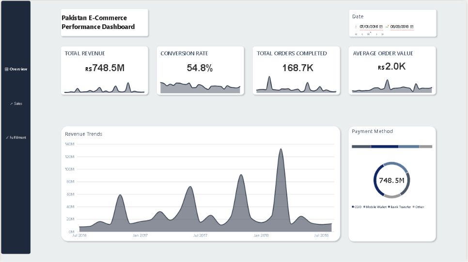
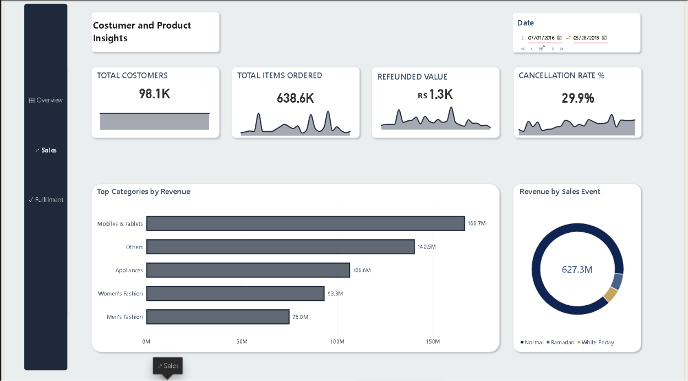
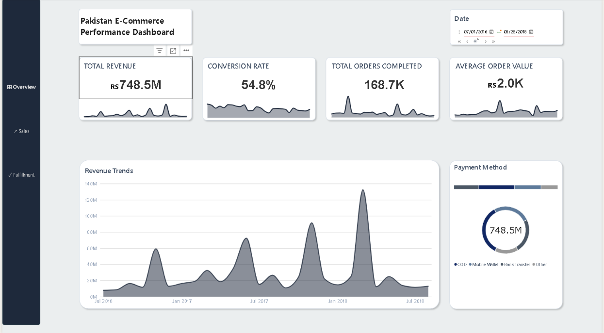

# Pakistan E-Commerce Analytics & Power BI Dashboard

I built this end-to-end data analytics project to take a messy, real-world retail dataset (~476,000 order line items from Kaggle's **Pakistan's Largest E-Commerce Dataset**, covering 2016 to 2018) from raw CSV files all the way to a 3-page interactive Power BI report.

Rather than loading a single flat spreadsheet directly into Power BI, I treated this like a real production workflow: exploring and cleaning the raw data in **Python (pandas)**, validating business metrics with **DuckDB SQL**, fixing schema edge cases in **Power Query**, and building a clean Star Schema with **DAX** measures.

---

## Why This Dataset Is Interesting

Working with Pakistani e-commerce data highlights very different operational challenges compared to card-first Western retail markets:

* **Cash-on-Delivery (COD) Dominance:** Roughly 80% to 90% of orders are placed using COD. While COD builds trust with buyers who prefer paying at the doorstep, it also leads to much higher refusal and cancellation rates.
* **Heavy Revenue Leakage:** Because so many COD orders are canceled or returned before payment is collected, top-line Gross Merchandise Value (GMV) looks much larger than actual realized cash. Separating booked GMV from net realized revenue is essential for realistic reporting.
* **Local Mega-Sales Spikes:** Promotional windows like **Ramadan 2017** and **White Friday 2017** create massive short-term surges in order volume that test product inventory and payment gateway stability.

---

## Project Workflow & Tech Stack

```text
+-----------------------+     +----------------------------+     +-----------------------+
|   Raw Kaggle CSV      | --> |  Python (Pandas) EDA & ETL | --> |  Star Schema CSVs     |
| (~500K+ Raw Records)  |     |  - Null & type inspection  |     |  - Fact_Orders.csv    |
+-----------------------+     |  - Status & payment maps   |     |  - Dim_Products.csv   |
                              |  - IQR price outlier trim  |     |  - Dim_Customers.csv  |
                              |  - Sales event tagging     |     +-----------+-----------+
                              +----------------------------+                 |
                                                                             v
+-----------------------+     +----------------------------+     +-----------------------+
| Power BI Dashboard    | <-- | Power Query Hygiene        | <-- | DuckDB Analytical SQL |
| - 1:* Star Schema     |     | - Full-column profiling    |     | - CTE pre-aggregation |
| - Central _Measures   |     | - Null & quote fixes       |     | - LAG & RANK windows  |
| - 3-Page SaaS Layout  |     | - Key trim & deduplication |     | - Cohort acquisition  |
+-----------------------+     +----------------------------+     +-----------------------+
```

* **Python (`pandas`, `numpy`):** Exploratory data analysis (EDA), text normalization, outlier filtering, feature engineering, and splitting the flat table into a Star Schema.
* **DuckDB (`SQL`):** Fast, in-memory SQL queries to cross-check KPIs, measure gateway cancellation rates, calculate Month-over-Month growth, and tag customer cohorts.
* **Power BI Desktop (`Power Query` & `DAX`):** Column profiling, relationship modeling, Time Intelligence measures, and interactive dashboard design.

---

## Step 1: Exploratory Data Analysis & Cleaning in Python

Before building any charts, I inspected the raw Kaggle file in `notebooks/01_pandas_cleaning_and_star_schema.ipynb` to see what needed fixing:

### Exploratory Data Analysis (EDA) Checks
* **Shape & Missing Values:** Checked row/column counts (`df.shape`, `df.info()`) and uncovered thousands of disguised nulls stored as MySQL `\N` markers, `"Null"` strings, and empty cells.
* **Cardinality & Label Noise:** Ran `.value_counts()` on categorical columns and found fragmented order statuses (`received`, `paid`, `closed`, `cod`, `order_refunded`, `exchange`) and messy payment gateway names (`easypay`, `jazzwallet`, `bankalfalah`, `payaxis`, `mcblite`, etc.).
* **Price & Quantity Distributions:** Used `.describe()` and quantile checks to spot extreme placeholder prices and test entries that would skew average order metrics.

### Data Cleaning & Feature Engineering
* **Standardized Headers & Text:** Converted raw column names to clean `snake_case` and normalized `status` and `payment_method` fields using `.str.lower().str.strip()`.
* **Consolidated Order Statuses:** Grouped 7 raw status values into clean lifecycle buckets (`received`, `paid`, `closed`, `cod` mapped to `complete`; `order_refunded`, `refund`, `exchange` mapped to `refunded`).
* **Grouped Payment Channels:** Mapped individual payment gateways into four clear categories: `cod`, `mobile_wallet` (`easypay`, `jazzwallet`), `bank_transfer` (`bankalfalah`, `payaxis`, `apg`, `mcblite`, `internetbanking`), and `voucher` (`easypay_voucher`, `jazzvoucher`).
* **Filtered Extreme Outliers:** Calculated the Interquartile Range (`IQR = Q3 - Q1`) on item prices and removed extreme pricing anomalies above `Q3 + 1.5 * IQR`.
* **Tagged Local Promotional Events:** Parsed `created_at` with `pd.to_datetime()` and created a `sales_event` column flagging **Ramadan 2017** (`2017-05-27` to `2017-06-24`) and **White Friday 2017** (`2017-11-20` to `2017-11-26`), labeling all remaining dates as `Normal`.
* **Exported Star Schema Tables:** Split the cleaned dataset into three relational tables (`Fact_Orders.csv`, `Dim_Products.csv`, and `Dim_Customers.csv`) to eliminate redundant text columns.

---

## Step 2: SQL Analysis in DuckDB

Next, I loaded the three cleaned CSVs into an in-memory DuckDB database (`notebooks/02_duckdb_analytical_sql.ipynb`) to verify baseline metrics and run 8 analytical queries before touching Power BI:

| # | Analysis | SQL Techniques Used | What It Answered |
| :--- | :--- | :--- | :--- |
| **1** | **Revenue by Order Status** | `SUM()` + `GROUP BY` | Separated completed revenue from canceled and refunded order volume. |
| **2** | **Cancellation Rate by Payment Mode** | Single-pass `SUM(CASE WHEN)` + `NULLIF` | Compared failure and cancellation rates across COD, Mobile Wallet, and Bank Transfers in a single table scan. |
| **3** | **White Friday vs. Normal Day Lift** | `INNER JOIN` + `IN` filter | Measured daily order and revenue spikes during White Friday promotions. |
| **4** | **Top 5 Ramadan Categories** | `JOIN` + `WHERE` + `LIMIT 5` | Identified top-selling product categories during Ramadan for inventory planning. |
| **5** | **Daily Order Volume & AOV** | `WITH` CTE + `COUNT(DISTINCT)` | Counted unique daily orders (`increment_id`) before computing Average Order Value. |
| **6** | **Month-over-Month Revenue Growth** | `DATE_TRUNC('month')` + `LAG() OVER` | Calculated monthly revenue changes and percentage growth without slow self-joins. |
| **7** | **Top 3 Categories Leaderboard** | `RANK() OVER (ORDER BY SUM() DESC)` | Ranked completed category revenue inside a CTE to isolate top performers. |
| **8** | **Customer First-Order Cohort** | `MIN(created_at) OVER (PARTITION BY)` | Tagged each customer's first purchase date while keeping row-level transaction detail intact. |

---

## Step 3: Data Modeling in Power Query & Power BI

### Power Query Hygiene
Before connecting tables in Power BI, I turned on full-dataset column profiling in Power Query Editor (instead of the default 1,000-row preview) to catch hidden schema issues:
* **Fixed CSV Quote Shifts:** Enforced `QuoteStyle.Csv` on `Fact_Orders` so embedded commas inside product SKUs would not shift text values into Date or Numeric columns.
* **Set Strict Data Types:** Cast `item_id`, `increment_id`, `customer_id`, and `sku` as **Text** so Power BI never tries to sum IDs, while casting dates and currency fields properly.
* **Cleaned Missing Categories:** Replaced remaining `\N` markers, `"Null"` strings, and blanks in `Dim_Products[category_name_1]` with `"Uncategorized"`.
* **Prevented Duplicate Key Errors:** Because Power BI's engine is case-insensitive and ignores trailing spaces, I applied `Trim` and `UPPERCASE` to `sku` and `customer_id` across all tables before removing duplicates in the dimension tables.

### Star Schema Relationships

```text
+-----------------------+               +-----------------------+
|     Dim_Products      |               |     Dim_Customers     |
|-----------------------|               |-----------------------|
| PK  sku (Text)        |               | PK  customer_id (Text)|
|     category_name_1   |               |     customer_since    |
|     price             |               +-----------+-----------+
+-----------+-----------+                           |
            | 1                                     | 1
            | (Single)                              | (Single)
            |                                       |
            | *                                     | *
            +-----------------> + <-----------------+
                                |
                    +-----------+-----------+
                    |      Fact_Orders      |
                    |-----------------------|
                    |     item_id (Text)    |
                    |     increment_id      |
                    | FK  customer_id (Hid) |
                    | FK  sku (Hidden)      |
                    |     created_at (Date) |
                    |     qty_ordered       |
                    |     net_revenue       |
                    |     status            |
                    |     payment_method    |
                    |     sales_event       |
                    +-----------------------+
```

| Table Name | Role | Approx. Rows | Key Columns |
| :--- | :--- | :--- | :--- |
| **`Fact_Orders`** | Fact Table | ~476,000 | `item_id`, `increment_id`, `customer_id` (FK), `sku` (FK), `created_at`, `qty_ordered`, `net_revenue`, `status`, `payment_method`, `sales_event` |
| **`Dim_Products`** | Dimension | 79,485 | `sku` (PK), `category_name_1`, `price` |
| **`Dim_Customers`** | Dimension | ~98,000 | `customer_id` (PK), `customer_since` |

Both relationships use **One-to-Many (`1:*`)** cardinality with **Single** cross-filter direction flowing from dimensions into `Fact_Orders`. Foreign keys (`sku` and `customer_id`) are hidden in Report View inside `Fact_Orders` so all slicing happens through the dimension tables.



---

## Step 4: DAX Measures & 3-Page Dashboard Walkthrough

All DAX calculations live inside a dedicated `_Measures` table (full formulas are saved in `powerbi/measures.txt`).

### Key DAX Measures
* **Revenue & Leakage:** `Total Revenue` (completed orders only), `GMV` (gross booked value), `Canceled Value`, `Refunded Value`, and `Net Realized Value`.
* **Order & Customer Metrics:** `Total Orders` (distinct `increment_id`), `AOV`, `Avg Order Price`, `Total Customers`, `Total Items Ordered`, `Conversion Rate`, and `Cancellation Rate %`.
* **Time Intelligence:** `Prior Month Revenue` (via `PREVIOUSMONTH`) and `MoM Revenue Growth %` (using `VAR` caching to power KPI trend badges).

### Dashboard Pages

#### Page 1: Executive Overview
* **Top KPIs:** Completed Revenue (`Rs 748.5M`), Conversion Rate (`54.8%`), Completed Orders (`168.7K`), and AOV (`Rs 2.0K`), paired with MoM trend indicators and monthly sparklines.
* **Visuals:** Monthly revenue area chart highlighting seasonal promotional peaks, alongside donut charts breaking down revenue by **Payment Method** and **Sales Event**.



#### Page 2: Sales Performance
* **Top KPIs:** Total Customers (`98.1K`), Total Items Ordered (`638.6K`), Average Order Price (`Rs 1.3K`), and Overall Cancellation Rate (`29.9%`).
* **Visuals:** Horizontal bar chart ranking **Top Categories by Revenue** (led by *Mobiles & Tablets* at `166.7M`, *Others* at `140.5M`, and *Appliances* at `106.6M`) paired with a **Revenue by Sales Event** breakdown.



#### Page 3: Fulfillment & Revenue Leakage
* **Top KPIs:** Gross Merchandise Value (`Rs 748.5M`), Canceled Value (`Rs 332.2M`), Refunded Value (`Rs 82.3M`), and Net Realized Value (`Rs 333.7M`).
* **Visuals:** An **Order Status Funnel** (`Complete`, `Canceled`, `Refunded`, `Payment Review`) alongside a **Fulfillment Matrix** cross-tabulating product categories against payment modes to pinpoint where cancellations cluster.



---

## Key Findings & Business Recommendations

1. **High Revenue Leakage Requires Stricter Order Confirmation:** Across the dataset, `Rs 332.2M` was lost to cancellations and `Rs 82.3M` to refunds against `Rs 748.5M` in gross value (a `29.9%` overall cancellation rate). Adding automated SMS or WhatsApp confirmation steps for first-time COD buyers can filter out non-serious orders before dispatch.
2. **Payment Behavior Varies Sharply by Product Category:** Cash on Delivery drives high order volume in everyday categories like *Men's Fashion* and *Women's Fashion* but carries elevated cancellation risk. Meanwhile, digital prepayments (`mobile_wallet` and `bank_transfer`) account for a much stronger share of high-ticket *Mobiles & Tablets* (`Rs 166.7M`) and *Appliances* (`Rs 106.6M`) sales. Offering small instant discounts on prepaid digital wallets can shift more buyers away from risky COD orders.
3. **Promotional Spikes Need Category-Specific Stocking:** Order volume surges dramatically during **Ramadan** and **White Friday**, particularly in electronics and fashion. Pre-allocating fast-moving SKUs ahead of these windows prevents stockouts and fulfillment delays.

---

## Repository Structure

```text
pakistan-ecommerce-bi-portfolio/
├── assets/
│   ├── model_star_schema.png
│   ├── page1_executive_overview.png
│   ├── page2_sales_performance.png
│   └── page3_fulfillment_leakage.png
├── data/
│   ├── raw/
│   │   └── Pakistan Largest Ecommerce Dataset.csv
│   └── processed/
│       ├── Fact_Orders.csv
│       ├── Dim_Products.csv
│       └── Dim_Customers.csv
├── notebooks/
│   ├── 01_pandas_cleaning_and_star_schema.ipynb
│   └── 02_duckdb_analytical_sql.ipynb
├── powerbi/
│   ├── Pakistan_Ecommerce_Executive_Report.pbix
│   └── measures.txt
└── README.md
```

---

## How to Reproduce Locally

1. **Download the Dataset:** Grab *Pakistan's Largest E-Commerce Dataset* from Kaggle and place `Pakistan Largest Ecommerce Dataset.csv` inside `data/raw/`.
2. **Run the Python Pipeline:** Open `notebooks/01_pandas_cleaning_and_star_schema.ipynb` and run all cells to generate `Fact_Orders.csv`, `Dim_Products.csv`, and `Dim_Customers.csv` inside `data/processed/`.
3. **Run the DuckDB Queries:** Execute `notebooks/02_duckdb_analytical_sql.ipynb` (or run `sql/analytical_queries.sql` in DuckDB) to verify the 8 analytical summary tables.
4. **Open in Power BI Desktop:** Open `powerbi/Pakistan_Ecommerce_Executive_Report.pbix`, update the local folder path in **Transform Data -> Data source settings** if prompted, and click **Refresh**.